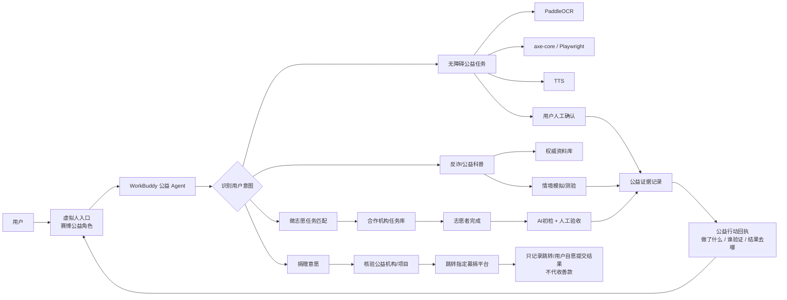
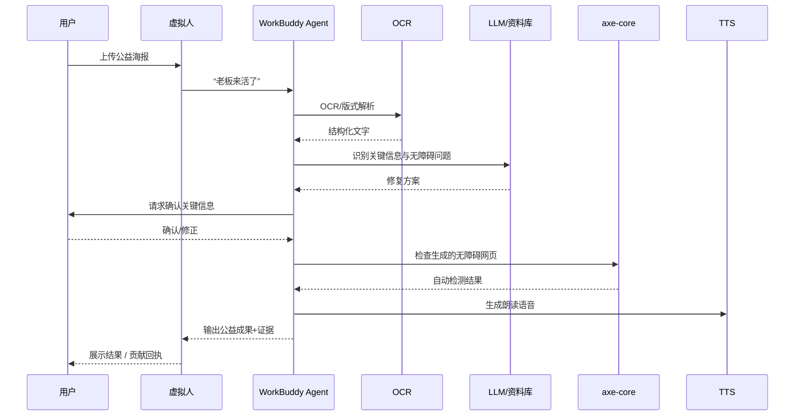
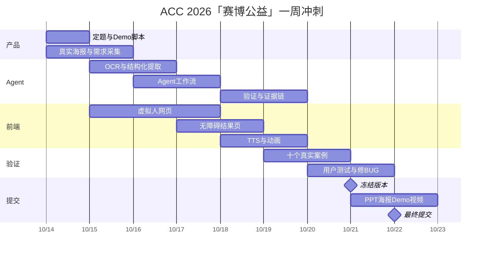

# “赛博公益 / 赛博磕头”虚拟人驱动 AI 公益项目深度研究

## 执行摘要

**研究结论先说：这个方向是有机会的，但真正值得做的并不是“虚拟人 + 捐款”，而是“虚拟人负责抢注意力，Agent 负责把注意力转化成可验证的公益行动”。**

你之前那张「赛博公益——求求你了，听我把话说完」「不求打赏，只求一点注意力」的海报，其实已经抓到了一个很好的产品洞察：**公益项目最大的瓶颈之一未必是人完全没有善意，而是注意力、参与门槛和反馈周期。** 现有成熟公益平台解决了项目展示、合规募捐和支付；Zooniverse、HOT、Project Sidewalk 证明“微任务 + 验证 + 贡献记录”能够形成真实社会产出；Be My Eyes 证明“AI + 人类志愿者接力”可以规模化；Ironmouse 等 VTuber 公益案例则证明虚拟角色本身可以成为非常强的公益注意力入口。citeturn1search8turn8search0turn9search9turn23search0turn7search8turn16search0

但在本次截至 **2026 年 10 月 14 日** 的公开网页、官方平台、GitHub 和论文检索样本中，我**没有发现一个成熟产品同时把以下四件事完整结合起来**：

> **有记忆点的虚拟角色/IP → AI Agent 主动理解用户 → 匹配并执行/辅助完成微公益任务 → 对结果进行机器或人工验证并生成“公益证据”。**

这就是你的机会。这个判断是对本次检索样本的归纳，不是“全球绝对不存在”的断言。

其中最值得参考的不是传统捐款网站，而是 **Project Sidewalk**：它让普通用户远程检查街道人行道无障碍问题，把任务拆成极低门槛的标注动作，再用 AI 验证、辅助打标签，最终沉淀成开放的、可以被城市和研究者实际使用的数据。截至其当前 GitHub 公开信息，Project Sidewalk 已部署在 10 个国家 50 多座城市，积累超过 340 万个人工标注点，并已在约 55 个城市部署 DINOv2 类 AI 验证和标签建议模型。citeturn23search0turn17search13

从 ACC 2026 的短周期出发，我最推荐你把项目定义为：

> **赛博公益：一个让 AI 虚拟人把“看一眼”变成“做一件真实小事”的公益 Agent。**

第一周不要碰复杂的募捐系统，也不要做大型公益任务市场，而做：

> **“赛博公益 · 无障碍急救站”**  
> 用户把一张公益活动海报、招募图、社区公告扔给虚拟人。  
> Agent 自动 OCR、理解内容、检查数字无障碍问题、生成大字版/纯文本版/朗读版/无障碍网页，再由用户确认。  
> 最后生成一张可以核验的“本次公益贡献报告”。

虚拟人可以一上来给用户“赛博磕一个”，但产品最后最好反转：

> “我本来想给你磕一个。”  
> “但你刚刚真的帮了一个人。”  
> **“这次咱俩都站着。”**

这比“你捐 5 块，我磕一个”在**公益真实性、Agent 必要性、现场演示效果、合规风险、技术完成度**上都明显更强。

本报告默认：**目标国家、预算、团队规模无特定约束**；由于 ACC 2026 在北京举行，法律与募捐部分优先按**中国大陆场景**分析。技术建议则尽可能使用国内可访问服务和开源方案。

### 核心判断

| 问题 | 研究结论 |
|---|---|
| 虚拟人有没有价值？ | **有，而且价值很大，但它是“注意力入口”，不是公益本身，也不是 Agent 本身。**VTuber 公益筹款已有明确成功案例。citeturn16search0turn16search7 |
| “磕头”梗能不能留？ | **能。**适合做一次性的入场仪式和传播钩子，不宜按捐款金额反复“下跪”，否则容易滑向情感勒索与公益娱乐化。 |
| 第一版该不该收钱？ | **强烈不建议。**中国互联网公开募捐有明确资质和指定平台制度；你的产品应链接到合规平台，而不是让钱进入你自己的账户。citeturn22search1turn4search0 |
| Agent 应该做什么？ | 匹配任务、调用 OCR/检测/TTS/资料库、生成结果、要求人确认、保存证据，而不是只陪聊。 |
| 最值得抄哪个产品结构？ | **Project Sidewalk + Zooniverse + Be My Eyes**。前两个解决任务和验证，后者解决 AI 与人类接力。citeturn23search0turn8search0turn7search5 |
| 最值得学哪个虚拟人案例？ | **Ironmouse × Immune Deficiency Foundation**：真实人物经历、虚拟角色、社区参与和正规公益机构闭环。citeturn16search0turn16search6 |
| 第一周最佳选题 | **公益内容无障碍修复 Agent。** |
| 第二候选 | **AI 反诈情境陪练/公益科普 Agent**，但不能只做问答，因为 2026 年 9 月官方已经上线“国家反诈AI”APP。citeturn21search5 |
| 长期方向 | **公益任务操作系统：虚拟 IP + 个性化 Agent + 微任务 + 验收 + 公益影响证据链。** |

## 竞品与相似项目全景

为了避免把不同类别混为一谈，我把竞品划成四层：

**公益基础设施**解决“钱和项目去哪里”；**微公益平台**解决“普通人怎么参与”；**AI 公益产品**解决“AI 如何降低服务门槛”；**虚拟创作者公益**解决“为什么用户愿意先停下来听你说”。

Agent 能力等级是本报告为了方便比较而做的研究性划分，不是各产品官方定义：

| 等级 | 含义 |
|---|---|
| A0 | 没有 Agent，主要是信息展示、交易或人工流程 |
| A1 | 推荐、规则自动化、简单个性化 |
| A2 | AI 能理解内容、生成/分析、与人多轮交互 |
| A3 | AI 能自主调用多个工具、执行工作流、获取反馈并验证结果 |

### 国内公益基础设施与 AI 公共服务

| 项目 | 目标用户与核心流程 | Agent 能力 | 技术/开源 | 公益/运营模式 | 可验证社会影响 | 优势、短板与可借鉴点 |
|---|---|---:|---|---|---|---|
| **腾讯公益 / 行为公益** | 用户浏览项目、捐赠；同时把步行、答题、阅读等日常行为转为低门槛公益参与 | A0–A1 | 核心平台闭源，技术栈未公开 | 指定互联网公开募捐平台 + 行为公益 | 项目募款、捐赠人次、行为参与数据可形成记录 | **优势：**入口和信任强；把日常行为变成公益非常值得借鉴。**短板：**并不是以 Agent 为中心，用户贡献与最终社会效果之间仍可能较远。腾讯官方介绍的“爱心接龙、一块走、每日益答”等产品就是“降低参与门槛”的典型。citeturn1search5turn1search8 |
| **支付宝公益** | 项目发现 → 信息了解 → 捐赠/参与 | A0–A1 | 闭源 | 公益机构、捐赠者和企业连接平台 | 募捐项目、善款和项目进展 | **优势：**支付场景天然顺滑、合规基础强。**可借鉴：**长期版本不要造支付系统，应把正规平台作为“最终资金出口”。支付宝官方定位强调低门槛、专业透明和高效连接。citeturn1search2 |
| **字节跳动公益** | 公益机构发布项目，创作者传播，用户参与/捐赠 | A0–A1 | 闭源 | 指定募捐平台 + 内容创作者传播 | 官网当前动态展示累计募捐金额、捐赠人次、机构、项目和创作者等维度 | **优势：**证明“内容创作者 → 注意力 → 公益”是一条成立的漏斗；与你的虚拟人思路非常接近，但没有以 Agent 任务执行为核心。官网截至检索时展示 2,000 余家合作机构、4,000 余项目等动态指标。citeturn1search14 |
| **公益时** | 将公益参与行为换算成可累计的“公益时间”记录 | A0–A1 | 平台实现闭源 | 行为记录/公益激励体系 | “公益时”本身就是可计量指标，不同公益行为按规则计入 | **非常值得借鉴。**你不一定做“功德值”，而可以做“经验证的公益贡献记录”。现行规则中甚至对捐赠行为对应公益时的计算做了明确约束。citeturn1search17 |
| **国家反诈AI APP** | 用户输入可疑文字、语音、视频等情境 → AI 判断风险 → 分析诈骗套路 → 推送案例和防范建议 | **A2** | 官方称融合大语言、多模态模型与智能体技术；未开源 | 公共安全服务 | 当前刚上线，尚无成熟公开效果数据可比较 | 这是 2026 年最重要的直接参考。2026 年 9 月正式上线，已经提供多模态风险研判、诈骗类型识别、案例关联等功能，因此你若做反诈，不能只是“AI 问答”。更有差异化的做法是**模拟诈骗陪练 + 能力前后测 + 帮助老人/亲友的公益任务**。citeturn21search5turn21search8 |

中国已有明确的“AI+公益”生态基础。世界互联网大会公开的“AI 公益行动计划”曾汇集 23 个主体的 33 个公益项目，覆盖无障碍、健康、生物多样性等方向；腾讯基金会与优图等也公开过 AI 标准接口和行业能力资源。这说明“AI 公益”并不是需要从零教育评委的新概念，你真正要证明的是**为什么你的交互机制比传统公益页面更容易让人行动**。citeturn1search7

### 国外众包、AI 辅助与虚拟人案例

| 项目 | 典型流程 | Agent能力 | 公开技术栈/开源 | 影响模式与指标 | 优势与短板 | 对“赛博公益”的启发 |
|---|---|---:|---|---|---|---|
| **Be My Eyes / Be My AI** | 盲人或低视力用户拍照 → AI 解释视觉内容 → 可继续追问 → 不足时转人工志愿者 | A2，且有人类兜底 | 核心服务闭源 | 2026 年官方宣布超过 **100 万盲人/低视力用户、1,000 万志愿者，覆盖 150+ 国家、180+ 语言** | **强：**AI 和志愿者不是二选一，而是接力。**弱：**上传照片存在个人信息和跨境处理风险 | 你的 Agent 也应该设计“AI做初筛 → 用户/志愿者确认 → 输出可验证成果”的 Human-in-the-loop。citeturn7search5turn7search8turn7search12 |
| **Zooniverse** | 研究机构上传海量资料 → 志愿者做几分钟微分类 → 多人汇总 → 科研成果 | A0–A1 | Panoptes 等组件开源；客户端 Apache-2.0 | 官方披露的平台规模约每周百万级分类任务，并已支撑数百篇同行评议论文 | **强：**任务极小、即时反馈、贡献统计、成果可以追溯。**弱：**缺少个性化 AI Agent | “我只有 3 分钟”也应该能帮助别人；**公益任务不能要求用户先成为专业志愿者。**citeturn8search0turn8search3turn8search23 |
| **HOT Tasking Manager** | 灾区/欠地图地区域 → 切成地图任务格 → 志愿者绘图 → 另一人验证 → 汇入 OpenStreetMap | A0–A1；2026 路线图正在增加 AI 分配、难度判断和验证 | 开源；Python、React/JS、PostgreSQL/PostGIS、FastAPI；BSD-2-Clause | 例如官方记录的一次 COVID 人道制绘图行动有 22,800 名志愿者、增加 460 万地图要素 | **强：**任务、领取、提交、验证、状态机非常完整。**弱：**GIS 上手门槛较高 | “领取任务→完成→审核→进入真实数据集”是赛博公益最值得复制的工作流之一。citeturn9search7turn9search9turn9search20 |
| **Project Sidewalk** | 用户在线“走街景” → 标注坡道、障碍、缺失人行道 → AI 验证/建议 → 形成开放无障碍数据 | **A2 型 AI-in-the-loop** | MIT；Scala/Play、Postgres/PostGIS、JavaScript、Docker；AI API 另有 Apache-2.0 仓库 | 50+ 城市、10 个国家、340 万+标注；AI 验证已用于约 55 城市 | **目前与你最接近的结构性竞品。**缺点是完整部署较重 | **重点抄：AI不是替用户公益，而是帮用户把公益贡献做得更快、更准，再让人验证。**citeturn23search0turn17search13 |
| **Project Sidewalk 学术原型** | 无障碍采集 + 众包 + CV/VLM 辅助 | A2 | 论文+开源生态 | 早期研究曾让 797 名参与者标注 205,385 个点、覆盖 2,941 英里；后续研究继续探索 VLM 引导 | 证明“众包公益 + AI反馈”不仅能做 Demo，还有学术依据 | 可用于 PPT 的技术/研究背书。citeturn10search5turn10academia29 |
| **Ironmouse × Immune Deficiency Foundation** | VTuber 直播/个人故事 → 社区互动 → 正规公益机构募捐、健康倡导 | A0；**角色是传播层，不是 Agent** | 直播和角色技术未公开；募捐经 Tiltify/机构渠道 | IDF 官方称其一次长期直播公益活动筹集超过 **50 万美元**；此前粉丝亦曾为 IDF 募资超 10 万美元 | **强：**虚拟人格可以把严肃议题传播给传统公益覆盖不到的人群。**弱：**高度依赖创作者个人影响力 | 这是“虚拟人为什么不是噱头”的最好证明之一：**IP 能做注意力入口，但后面必须连接正规机构和真实行动。**citeturn16search0turn16search6turn16search12 |
| **Tiltify VTuber 公益活动** | VTuber/主播发起活动 → 直播目标、互动、奖励机制 → 第三方公益筹款 | A0–A1 | 平台闭源 | 有专门 VTuber Charity 活动；Tiltify 支持目标、投票、matching 等互动 | **强：**“娱乐互动+公益”非常成熟。**弱：**仍主要围绕钱，而非志愿任务 | 可以学习即时反馈、里程碑、动画，而不要照搬资金流。citeturn16search1turn16search4turn16search23 |

### 竞品真正告诉我们的事

Project Sidewalk、HOT 和 Zooniverse 的共同特点，并不是它们用了多先进的模型，而是它们都建立了：

> **真实需求 → 小任务 → 用户行动 → 验证 → 可被下游实际使用的结果。**

这恰恰是大量“AI 公益 Demo”最容易缺失的一环。citeturn23search0turn9search9turn8search18

另一方面，Ironmouse 的案例说明，你最开始那个看起来很抽象的“虚拟人磕头”想法并不是完全错位：**互联网人格本身确实可以降低严肃议题的传播门槛。** 关键问题是不能让“磕头”成为产品终点。citeturn16search0turn16search3

因此一个更完整的产品漏斗应当是：

**有梗 → 停留 → 对话 → 行动 → 验收 → 影响。**

而不是：

**有梗 → 扫码 → 捐钱 → 完。**

## 开源代码、模型、API 与第三方服务

### 最值得直接复用的开源组件

以下“部署难度”是针对 **1–4 人黑客松团队**的研究判断，不是官方评级。

| 资源 | 用途 | 许可证 | 主要语言 | 难度 | 对你最直接的用途 |
|---|---|---|---|---:|---|
| [LangGraph](https://github.com/langchain-ai/langgraph) | 有状态、多步骤 Agent 工作流 | MIT | Python / TypeScript 生态 | 中 | 如果 WorkBuddy 内部工作流不够，可以作为 Agent 后端状态机；适合“解析→工具→人工确认→继续执行”。官方仓库定位即长期运行、有状态 Agent 工作流。citeturn15search0turn15search8 |
| [Playwright](https://github.com/microsoft/playwright) | 浏览器自动化、网页验证 | Apache-2.0 | TypeScript | 易–中 | Agent 自动打开修复后的公益页面、运行检查、截图留证；官方亦提供 Agent/MCP 方向的浏览器工具。citeturn15search1turn15search29 |
| [axe-core](https://github.com/dequelabs/axe-core) | 自动化 Web 无障碍检查 | MPL-2.0 | JavaScript | **易** | 你的 MVP 核心：检测标题、ARIA、对比度等可自动检查问题，并形成前后差异报告。citeturn19search1turn19search13 |
| [Accessibility Insights for Web](https://github.com/microsoft/accessibility-insights-web) | 浏览器级无障碍审核 | MIT | TypeScript | 中 | Demo 前做人工+自动复核；适合作为你自己的 QA 工具，而不一定嵌进产品。citeturn19search2turn19search34 |
| [Pa11y](https://github.com/pa11y/pa11y) | 自动化无障碍 CLI/CI | LGPL-3.0-only | JavaScript | 易 | 可作为 axe 之外第二个自动化验证器，部署简单。citeturn15search2turn15search18 |
| [PaddleOCR](https://github.com/PaddlePaddle/PaddleOCR) | 海报/截图文字和版式识别 | Apache-2.0 | Python | **易–中** | 公益海报 → 结构化文本，是第一周最实用的工具之一；当前 3.x 官方仓库支持多语言文档解析等能力。citeturn17search3turn17search9turn17search27 |
| [CosyVoice](https://github.com/FunAudioLLM/CosyVoice) | 本地/服务端 TTS | 代码 Apache-2.0；**模型权重应逐个核对模型卡许可** | Python | 中–高 | 虚拟人朗读公益内容、无障碍语音版。代码许可明确，但不要假定所有预训练权重的商用许可和代码完全相同。citeturn17search5turn17search23turn17search2 |
| [three-vrm](https://github.com/pixiv/three-vrm) | 浏览器 VRM 3D 虚拟人 | MIT | TypeScript | **易** | 把你自己的虚拟人直接放到网页里；支持 Three.js/VRM，纯前端即可运行。citeturn23search2 |
| [TalkingHead](https://github.com/met4citizen/TalkingHead) | 3D 虚拟人实时口型、TTS | MIT | JavaScript | **易–中** | 比自己造 lipsync 系统快得多；支持外部 TTS、3D 全身头像。**注意：代码 MIT 不代表示例头像素材都是商用许可，仓库明确列出部分示例头像仅限非商业用途。**citeturn23search1turn23search3 |
| [HOT Tasking Manager](https://github.com/hotosm/tasking-manager) | 微任务领取/验证架构参考 | BSD-2-Clause | Python + React/JS | 高 | **不要第一周部署它；读它的任务状态机。**长期做“赛博功德办”时再参考。citeturn9search9 |
| [Project Sidewalk](https://github.com/ProjectSidewalk/SidewalkWebpage) | 众包无障碍任务系统 | MIT | Scala + JavaScript | 高 | 最佳架构参考。完整部署较重，而且开发环境还需要相应数据库/配置资源，不适合直接 fork 后参加一周赛。citeturn23search0 |
| [Project Sidewalk AI API](https://github.com/ProjectSidewalk/sidewalk-ai-api) | AI 标注验证 | Apache-2.0 | Python | 中–高 | 学习“AI先判断、人最终验证”的设计。citeturn17search13 |
| [Zooniverse Panoptes Python Client](https://github.com/zooniverse/panoptes-python-client) | 众包任务平台 API | Apache-2.0 | Python | 中 | 长期可以研究如何对接真正的微志愿任务或借鉴 subject/workflow 模型。citeturn8search10 |

这里尤其需要注意一个工程原则：

> **不要为了比赛把每个功能都本地部署。**

一周版最合理的组合是：

**WorkBuddy Agent + 前端虚拟人 + PaddleOCR + axe-core + 云 TTS。**

这样已经足够构成一个真正的多工具 Agent。

### 可复用第三方能力

| 类别 | 推荐 | 怎么用 | 注意点 |
|---|---|---|---|
| **TTS** | 腾讯云 TTS | API/WebSocket 实时语音合成；有多音色、语速等控制 | 国内网络环境友好，适合现场 Demo。citeturn18search1turn18search7 |
| | 阿里云智能语音交互 | REST/实时 TTS | REST 接口支持音色、语调、语速、音量等参数。citeturn18search0turn18search3 |
| | 火山引擎豆包语音 | 双向流式 TTS | 适合需要“边生成边说”的数字人。citeturn18search8 |
| | Web Speech API | 浏览器免费 fallback | 无需服务端即可快速 Demo；但浏览器实现、语音质量和精确 lipsync 能力有限，TalkingHead 项目也明确指出 Web Speech API 缺少其所需的精确音频时间信息。citeturn18search9turn23search3 |
| **虚拟人** | three-vrm + 自有 VRM | WebGL 直接渲染 | 最安全的是你自己做/自己拥有版权的角色。citeturn23search2 |
| | TalkingHead | 嘴型、表情、动作 + TTS | 非常适合赛博磕头这种互动；素材许可要独立检查。citeturn23search3 |
| **OCR** | PaddleOCR 3.x | 图片→文字→字段 | 优先本地处理含手机号/姓名的图，减少隐私上传。citeturn17search9turn17search27 |
| **无障碍** | axe-core + Playwright | Agent 自动检测修复后的网页 | 自动化检测无法证明完整 WCAG 合规，必须配人工检查。W3C 明确指出部分 WCAG 测试只能由人工完成。citeturn19search20turn19search4 |
| **标准** | WCAG 2.2 | 输出修复报告的规则依据 | 当前 W3C 标准可作为 Demo 的可验证外部基准。citeturn19search0 |
| **公益募捐** | 腾讯公益、支付宝公益、字节公益等指定平台 | **只跳转官方募捐项目，不代收款** | 这是大陆 MVP 最稳妥的方案。现行制度明确指定互联网公开募捐服务平台。citeturn4search0turn22search1 |
| **公益项目核验** | 民政系统“慈善中国”及募捐平台公开信息 | Agent 检查机构、项目和募捐信息 | 政府公开指引也建议公众通过“慈善中国”等渠道核验组织和项目。citeturn0search27 |
| **志愿任务来源** | 志愿云 | 人工导入或合作对接志愿项目 | 志愿云现有实名志愿者、项目招募、服务时长记录等完整业务，但此次检索**没有找到可确认开放给普通开发者的公共 API 文档**，不要在 PPT 中虚构“已接 API”。citeturn20search5 |
| | Idealist / VolunteerMatch | 海外志愿机会检索、后续 API/合作 | 官方当前页面提供 API & Integrations，并有大量线上/线下志愿机会，但商业 API 接入条件应另行确认。citeturn16search2turn16search5 |

### 建议系统架构



**最关键的架构决定，是让捐款路径从你的资金系统旁边绕过去。**你的 Agent 可以查项目、解释项目、核验机构、推荐匹配，但最终付款跳到指定公益募捐平台完成，而不是进入你的账户。中国 2026 年实施的《互联网公开募捐服务平台管理办法》明确要求相应平台不得代慈善组织接受捐赠财产。citeturn22search1turn22search5

## 法律、合规与伦理边界

### 募捐不是“收个二维码就行”

这是你最开始“你捐款就算公益了”这个版本最大的问题。

按照中国大陆现行慈善募捐规则，慈善组织开展互联网公开募捐，应当按照制度通过指定互联网公开募捐服务平台发布相关信息。2026 年 5 月起施行的新平台管理办法又进一步规范了资质查验、信息管理、投诉处理、数据管理等要求，并明确平台不得代慈善组织接受捐赠财产。citeturn0search0turn22search1

截至 2026 年公开官方名单，目前有 **29 家指定互联网公开募捐服务平台**，包括腾讯、阿里/支付宝、字节等体系中的平台。citeturn4search0

所以 MVP 的红线很明确：

**不要：**

> “扫我的二维码 → 钱进我的微信/支付宝 → 我以后替你捐。”

应该是：

> “Agent 帮你找到并核验项目 → 显示官方机构、募捐备案/来源 → 点击后跳转指定公益平台 → 用户直接向正规渠道完成捐赠。”

这样你甚至可以把“不收钱”做成产品梗：

> **“本赛博功德办拒收香火钱。”**  
> “想捐？我带你去该去的地方。”

这既抽象，又合规得多。

### 隐私风险比你想象的大

公益场景很容易出现敏感信息。例如用户上传的求助截图、活动海报、聊天记录里可能存在姓名、手机号、位置、医疗信息、支付信息、人脸甚至未成年人数据。《个人信息保护法》将生物识别、医疗健康、金融账户、行踪轨迹以及不满十四周岁未成年人的个人信息列为敏感个人信息类型；处理不满十四周岁未成年人个人信息还涉及监护人同意要求。citeturn6search1turn6search9

因此一周版应当：

| 项目 | MVP 做法 |
|---|---|
| 图片保存 | 默认不长期保存原图 |
| 手机号/身份证等 | OCR 后自动遮罩或提醒用户删除 |
| 数据库 | 保存任务 ID、结果、检测分数，不保存不必要的原始敏感信息 |
| 模型 API | 上传前提示会发送给第三方；能本地 OCR 就尽量本地 |
| 删除 | 提供“一键删除本次数据” |
| Demo 数据 | 优先使用你自己制作或得到授权的公益海报 |
| 未成年人 | 不收年龄、学校、身份证等非必要信息 |

Be My Eyes 自己的隐私政策也明确讨论了用户提交给视觉 AI 的图片/视频中可能包含个人信息，以及与 AI 服务商之间的数据处理问题；这很好地说明“AI 做公益”并不会自动免除隐私责任。citeturn7search12

### AI 虚拟人必须考虑生成内容标识

中国《人工智能生成合成内容标识办法》已于 **2025 年 9 月 1 日施行**，涵盖文本、图片、音频、视频和虚拟场景等生成合成内容，在适用情形下涉及显式、隐式标识要求。citeturn22search10turn22search15

所以你的页面角落可以干脆写：

> **🤖 本角色为 AI 虚拟角色；部分语音、文本和动画由 AI 生成或驱动。**

不要把虚拟人包装成真正的公益工作人员、受助者或真人专家。

对你反而有利——这会让“赛博公益办事员”的世界观更完整。

### 虚拟人不是随便复制一个真人

如果角色基于真人面容、声音或者明显可识别的形象，需要获得相应授权。民法典相关人格权规定保护自然人的肖像；最高人民法院也明确解释，自然人声音的保护参照肖像权相关规则。citeturn22search0turn22search13

因此最安全的路径就是：

**自己的原创角色 + 自己的声音，或者明确授权的 TTS 音色。**

尤其不要为了效果：

> 克隆老师、明星、公益人物的声音，让其“替你宣传公益”。

那会迅速把一个公益项目变成法律风险项目。

### “抽象”可以，但不要把受助者变成笑料

“磕头”本身并没有必要删除。

问题在于**谁在被调侃。**

我建议：

> 调侃虚拟人。  
> 调侃互联网。  
> 调侃“功德系统”。  
> 调侃用户拖延。  
> **不要调侃残障人士、老人、贫困群体、受骗者或者求助者。**

例如：

> “老板求你做一道无障碍任务，我给你磕了。”

很好。

但：

> “看这个残障人士多惨，捐五块让我再磕一个。”

就完全不行。

Be My Eyes 在 2026 年甚至专门公开提醒，不应把盲人用户和志愿者之间的帮助过程截取、传播成供社交媒体消费的内容，并明确反对这种“去人性化”的呈现方式。这是公益产品非常值得借鉴的伦理边界。citeturn7search15

### 合规风险矩阵

| 风险 | 严重度 | MVP发生概率 | 推荐措施 |
|---|---:|---:|---|
| 自己收公开募捐款 | 极高 | 中 | **完全不做。只跳转指定平台。** |
| 虚构“帮助了多少人” | 高 | 中 | 只显示任务完成、审核通过等确实可验证指标 |
| 上传包含敏感信息 | 高 | 高 | 本地 OCR、脱敏、短期保存、明确删除机制 |
| AI错误公益建议 | 高 | 中 | 权威来源 + 来源显示 + 人确认 |
| 冒充专家/公益机构 | 高 | 低 | 明确“AI虚拟角色”，不自称官方 |
| 未经授权使用脸/声音 | 高 | 中 | 使用原创 IP、自有声音/正规授权 |
| “磕头”造成道德胁迫 | 中 | 中 | 磕头只作为剧情开场，不与捐款金额绑定 |
| 自动无障碍检测误称“100%合规” | 中高 | 高 | 写“自动检查结果”，增加人工检查，不写“全面符合 WCAG” |
| 公益任务其实没需求 | 极高 | 高 | 每一任务必须有来源、接收方和验收条件 |

W3C 明确说明，WCAG 的一部分测试可以自动化，但另一些必须由人工完成，所以“axe 检测 0 error”不能等同于“100% 无障碍”。citeturn19search20

## 三阶段 MVP 路线

### 一周可交付：赛博公益 · 无障碍急救站

**这是我最推荐你参加 ACC 2026 的版本。**

产品的一句话：

> **“把看不懂、读不了的公益海报，交给 AI；三分钟，把它修成更多人能使用的版本。”**

#### 用户体验

打开页面。

虚拟人出现。

> “你来都来了，我先给你磕一个。”

动画。

> “不过今天别给我钱。”  
> “帮我修一张海报吧。”

用户上传一张公益活动海报。

Agent 开始工作：

**OCR → 理解活动 → 找问题 → 生成无障碍版 → 检测 → 用户确认 → 输出结果。**

最后：

> “老板，刚才那张图片，现在能被更多人读到了。”  
> “这次不用我磕。”  
> **“咱俩站着。”**

#### 功能范围

| 模块 | 第一周必须做 | 不做 |
|---|---|---|
| 虚拟人 | 一个角色、待机、说话、磕头/鞠躬动画 | 高级动作生成 |
| 输入 | 图片/JPG/PNG 公益海报 | PDF 大型文档系统 |
| OCR | 标题、时间、地点、主办方、活动说明、报名方式等 | 追求所有字体 100% OCR |
| Agent | 自动理解字段、识别缺失信息、生成修复建议 | 开放式万能聊天机器人 |
| 无障碍 | 纯文本版、大字版、结构化 HTML、alt 描述、朗读 | 宣称通过完整 WCAG AA 认证 |
| 验证 | axe 自动检查生成网页 + 用户确认 OCR | 专业认证 |
| 公益证据 | 保存“原图→提取→修改→审核→结果链接” | 区块链 |
| 分享 | 一个结果 URL / 二维码 | 社交平台全套 SDK |
| 捐款 | **不做** | 任何自有收款 |

#### 技术路线



自动化检测只是无障碍审核的一部分，因此这里把“用户确认”和自动检测放在同一工作流里，而不是把 AI 判定直接当最终事实。citeturn19search20turn19search28

#### 验收指标

ACC 的 Demo 不应该只说“用了 AI”。

你可以现场给评委展示：

| 指标 | 建议目标 |
|---|---:|
| 真实/授权公益海报样本 | ≥ 10 张 |
| 每张从上传到结果生成 | ≤ 3 分钟 |
| 关键字段 | 全部经过人工确认 |
| 生成模板 axe Critical 级问题 | **0** |
| 每个任务 | 100% 留下来源、修改、检测、确认记录 |
| 真人体验测试 | ≥ 5 人 |
| 能被键盘完整操作的主要流程 | 100% |
| 现场网络失效 | 有至少 1 个预缓存 Demo |

这里最重要的不是追求一个虚假的“AI准确率99%”，而是：

> **每个公益行为都有证据。**

例如：

```text
公益任务 #CYB-0017

原内容：
校园公益义卖活动海报

Agent发现：
✓ 图片中包含 426 字正文
✓ 活动时间未在正文结构中明确标记
✓ QR码没有文本替代说明
✓ 图片本身无法直接被屏幕阅读器理解

完成：
✓ 提取结构化文本
✓ 生成大字版
✓ 生成HTML无障碍版
✓ 生成朗读版
✓ 添加二维码目的说明

人工确认：
✓ 2026-10-19 19:32

自动检测：
axe critical: 0

结果：
/impact/CYB-0017
```

这就是你和普通 ChatGPT Wrapper 的区别。

#### 一周时间表

按你提供的赛制，提交截止是 **10 月 22 日 20:00**。以当前 10 月 14 日计算，实际应把 10 月 21 日视为产品冻结日，不要等到最后一天开发。



#### 人员分工

如果只有你一个人，**不要做 3D 角色建模**，直接用已有原创素材/VRM，时间留给 Agent 和真实案例。

若有四个人，最佳分工是：

| 人 | 核心职责 |
|---|---|
| A | 产品、WorkBuddy Agent、整体集成 |
| B | 前端、虚拟人、动画、TTS |
| C | OCR、无障碍检测、测试和数据 |
| D | 真实公益素材、用户测试、PPT、海报、演示 |

### 一个月可扩展：赛博功德办 · 微公益任务 Agent

一周版验证的是“一个任务”。

一个月版应该验证：

> **Agent 能不能根据一个人的时间和能力，找到真正需要他的公益小任务？**

进入网站：

> “老板，今天有几分钟？”

用户：

> “十分钟。”

Agent：

> “会 PS 吗？”

> “不会。”

> “会说人话吗？”

> “应该会。”

> “那来。这里有一张社区老人活动海报，机器识别出来的活动时间可能有问题，你帮我确认一下。”

这时候产品开始有灵魂了。

#### 任务类型

第一阶段只选三种容易核验的公益任务：

**无障碍内容修复**：海报转文字、图片替代文本、大字版、朗读校正。

**公益资料清理**：活动信息结构化、地点/时间确认、重复信息检查。

**数字安全教育**：反诈情境测试、诈骗话术分类、老年友好解释校验。

在反诈方向上，目前已有“国家反诈AI”提供风险判断、诈骗类型识别和防范建议，所以你的差异化不该是“另一个反诈聊天机器人”，而应该变成：

> **你作为志愿者接受 Agent 的模拟诈骗挑战 → 学会识别 → 帮家人完成一场反诈训练 → 形成前后测结果。**

官方“国家反诈AI”已经证明多模态智能体用于公共反诈服务是现实产品方向；2026 年的 ROLESafe、ScamPilot、ImmuniFraug 等研究也正在探索角色扮演和 LLM 情境模拟的反诈训练价值。citeturn21search5turn21search0turn21search6turn21search18

#### Agent 工作流

```text
用户画像
  ↓
“我有 5 / 10 / 30 分钟”
  ↓
技能与兴趣
  ↓
Agent 找任务
  ↓
解释：为什么有人真的需要它
  ↓
领取
  ↓
AI 预处理
  ↓
用户完成关键判断
  ↓
AI 初检
  ↓
人/机构验收
  ↓
结果进入真正的公益素材/数据库
  ↓
生成公益行动回执
```

最重要的一步是：

**“结果进入哪里？”**

如果没有这一步，你做的是游戏。

有了这一步，你才做的是公益。

#### 一个月验收目标

建议不是追求下载量，而是追求：

| 指标 | 一个月目标 |
|---|---:|
| 真任务 | ≥ 100 个 |
| 明确任务来源 | 100% |
| 至少合作/确认需求方 | 1–3 个 |
| 实际参与测试者 | ≥ 30 人 |
| 完成任务 | ≥ 50 个 |
| 有明确验收结果 | 100% |
| AI初检后被人工接受率 | 可统计并公开 |
| 用户第二次回来继续做任务 | 纳入核心指标 |
| 每任务平均时间 | 记录真实值 |
| 最终被机构/项目使用的产出 | **必须独立统计** |

不要把：

> 页面访问 1 万次

当作：

> 帮助了 1 万人。

公益影响指标必须尽量从“传播指标”向“行为指标”和“结果指标”移动。

### 长期：赛博公益 Agent 网络

长期版本才考虑把三个世界合起来：

**虚拟人 IP + 公益任务网络 + 合规募捐入口。**

可以成为：

> **“公益世界的任务路由器。”**

用户不需要知道自己应该关注无障碍、反诈、环境还是社区。

Agent 先问：

> “你今天能提供什么？”

时间？

技能？

钱？

位置？

知识？

然后给他一件具体的事情。

长期系统可以变成：

```text
公益机构
    │
    ├── 发布真实需求
    │
    ▼
任务标准化 Agent
    │
    ├── 拆分成 3 / 10 / 30 分钟任务
    ├── 定义验收标准
    └── 标识隐私/安全要求
    │
    ▼
赛博公益任务池
    │
    ▼
用户 Agent
    │
    ├── 时间
    ├── 技能
    ├── 兴趣
    └── 历史贡献
    │
    ▼
个性化任务
    │
    ▼
AI辅助 + 人类完成
    │
    ▼
自动检查 / 同行验证 / 机构验收
    │
    ▼
公益影响记录
```

若用户说：

> “我什么都不会，但我愿意捐 20 块。”

Agent 才切到：

> “好的。我找到了三个经过核验的正规项目。我解释一下它们分别在干嘛。”

然后跳转指定募捐平台。

这样**捐款只是 Agent 能调用的一个出口，而不是整个产品。**

长期商业/持续运营模式也可以成立：

**C 端免费**，让公众参与公益。

**公益机构端**提供 AI 内容无障碍、任务拆解、志愿者协作、数据整理等 SaaS/技术公益服务。

**企业 CSR 端**可以购买员工志愿活动任务管理和可审计影响报告。

这里尤其不建议：

> 从公益善款中抽佣。

一方面在信任上很伤，另一方面中国互联网公开募捐平台和慈善资金本身有严格制度。citeturn22search1turn22search3

## 差异化战略与推荐优先级

### 你真正应该拥有的不是“磕头”，而是一条完整的转化链

你的护城河不应该描述成：

> “我们的 AI 虚拟人会磕头。”

这非常容易复制。

应该描述成：

> **“传统公益告诉用户‘请关注这个问题’，赛博公益则让 Agent 当场把关注变成一件可以完成、可以验收、可以留下证据的小事。”**

完整链路：

> **注意力 → 理解 → 匹配 → 行动 → 验证 → 反馈 → 再参与**

其中虚拟人只占第一步和最后一步。

这反而让你的“抽象”有了意义。

### 四层产品结构

我建议你以后无论写 PPT 还是和评委解释，都用下面四层：

| 层 | 核心问题 | 你的答案 |
|---|---|---|
| **Attention** | 为什么用户愿意停下来？ | 抽象、有梗、有性格的虚拟人 |
| **Agent** | 为什么不是普通网页？ | AI 理解用户、匹配任务、调用工具、辅助执行 |
| **Action** | 为什么不是聊天机器人？ | 用户真的完成某件公益任务 |
| **Evidence** | 为什么相信产生了价值？ | 自动检查 + 人确认 + 来源 + 结果去向 |

这四个词可以直接做你 PPT 的一页：

> **Attention → Agent → Action → Evidence**

我甚至建议产品内部把这个叫：

> **A³E Loop**

但展示时中文解释就好，不必故意堆英文。

### 不同方案优先级

下面是我按照 ACC 短期赛事进行的主观评分，满分 5 分。它是决策工具，不是第三方评测。

| 方案 | 公益真实性 | Agent 必要性 | 一周可做性 | 现场效果 | 合规安全 | 差异化 | 总分 / 30 |
|---|---:|---:|---:|---:|---:|---:|---:|
| **公益海报无障碍急救站** | 5 | 5 | 5 | 5 | 5 | 4 | **29** |
| **公益微任务 Agent** | 5 | 5 | 3 | 5 | 4 | 5 | **27** |
| **反诈情境陪练** | 5 | 4 | 4 | 5 | 5 | 3 | **26** |
| **赛博功德小游戏** | 3 | 3 | 5 | 5 | 5 | 5 | **26** |
| **虚拟人讲公益科普** | 3 | 2 | 5 | 5 | 5 | 3 | **23** |
| **虚拟人 + 正规公益捐款跳转** | 4 | 2 | 5 | 5 | 3 | 3 | **22** |
| **虚拟人自己收捐款** | 2 | 1 | 5 | 5 | **1** | 4 | **18** |

这里有一个非常关键的竞争格局变化：**国家反诈AI 已在 2026 年 9 月上线**，所以“AI 帮你判断是不是诈骗”这个功能本身很难再成为 ACC 上的强差异化；相反，数字无障碍场景既已有国际成熟研究和开源技术作为依据，又仍有很大空间让 Agent 帮普通人参与。citeturn21search5turn23search0

因此我的排序是：

**第一优先：无障碍公益 Agent。**

**第二优先：真实微公益任务 Agent。**

**第三优先：反诈陪练，而不是反诈问答。**

**最后才是纯募捐。**

### “赛博磕头”的最佳处理方法

我会保留。

但只保留成一个**反差式 IP 行为**。

第一次进网站：

> “第一次见面，没什么才艺，先给您磕一个。”

咚。

然后：

> “好了，头磕完了，说正事。”

用户再次点“让她磕一个”：

> “不磕了。”  
> “你先帮我干件好事。”

完成任务之后：

> “今天本来应该我谢谢你。”  
> “算了，公益不是谁欠谁的。”  
> **“咱俩都站着。”**

这样，“磕头”从低俗噱头变成了一个完整的人格叙事。

甚至可以把你的核心文案改成：

> # 赛博公益
> ## 求求你了，听我把话说完
>
> **不要你的钱。**
>
> **给我三分钟。**
>
> 让 AI 带你完成一件真的有用的小事。

我认为这个比：

> “扫码捐款。”

强很多。

## 检索策略、关键来源与 ACC 提交清单

### 本次研究怎么搜的

本次检索截至 **2026 年 10 月 14 日**，采用的是“中文官方优先 + 原始资料优先”的路线，而不是简单搜索“AI 公益”关键词。

主要检索方向包括：

| 检索层 | 重点来源 |
|---|---|
| 中国公益平台 | 民政部门、腾讯/支付宝/字节等官方公益页面 |
| 法规 | 民政部、国家网信办、司法/法院系统、地方民政部门 |
| AI 公益 | 世界互联网大会、平台官方案例 |
| 无障碍公益 | W3C、Project Sidewalk、Be My Eyes、原始论文 |
| 微任务/志愿者 | Zooniverse、HOT、志愿云、VolunteerMatch/Idealist |
| 虚拟人公益 | 公益机构本人页面、Tiltify |
| 开源技术 | 项目官方 GitHub 仓库及 LICENSE |
| 反诈 | 公安系统/中国驻外机构官方发布、原始研究论文 |

“全网竞品”在实践中不可能证明绝对穷尽，因此本报告的结论应理解为**对公开可检索、有足够可信证据的代表性产品和项目进行结构化扫描**。封闭企业产品的内部技术栈通常没有公开资料，我在这类项目上统一标记为“未公开”，没有通过猜测补全。

社会影响数字同样要区分：Be My Eyes、Project Sidewalk、IDF 等数字主要是相关组织自己的官方披露，并不等同于独立第三方审计数据。citeturn7search8turn23search0turn16search0

### 建议保留的核心参考来源

| 主题 | 原始/官方来源 |
|---|---|
| 中国互联网公开募捐新规 | 国家网信办转载三部门《互联网公开募捐服务平台管理办法》：citeturn22search1 |
| 指定募捐平台 | 深圳市民政部门公布当前 29 家指定平台名单：citeturn4search0 |
| AI 合成内容标识 | 国家网信办《人工智能生成合成内容标识办法》及答记者问：citeturn22search10turn22search15 |
| 个人信息/未成年人 | 国家网信办《个人信息保护法》相关官方文本：citeturn6search1 |
| 肖像与声音 | 最高人民法院人格权专题：citeturn22search0turn22search6 |
| 中国 AI 公益生态 | 世界互联网大会 AI 公益行动：citeturn1search7 |
| 当前反诈 AI | “国家反诈AI”APP 官方信息：citeturn21search5 |
| Be My Eyes | 官方 Be My AI / 2026 规模数据：citeturn7search5turn7search8 |
| Zooniverse | 官方志愿者和成果资料：citeturn8search0turn8search23 |
| HOT | 官方 Tasking Manager/GitHub：citeturn9search9turn9search20 |
| Project Sidewalk | [官方 GitHub](https://github.com/ProjectSidewalk/SidewalkWebpage)：citeturn23search0 |
| Project Sidewalk AI | [sidewalk-ai-api](https://github.com/ProjectSidewalk/sidewalk-ai-api)：citeturn17search13 |
| W3C 无障碍标准 | WCAG 2.2：citeturn19search0 |
| VTuber 公益 | Immune Deficiency Foundation 对 Ironmouse 公益案例的官方记录：citeturn16search0turn16search6 |
| 虚拟人前端 | [three-vrm](https://github.com/pixiv/three-vrm)、[TalkingHead](https://github.com/met4citizen/TalkingHead)：citeturn23search2turn23search3 |
| OCR | [PaddleOCR](https://github.com/PaddlePaddle/PaddleOCR)：citeturn17search9 |
| 无障碍检测 | [axe-core](https://github.com/dequelabs/axe-core)：citeturn19search13 |

### ACC 2026 最终提交建议

按照你提供的赛制，你最终需要的不是一个“伟大愿景”，而是一个 **10 月 22 日晚上八点以前真正能跑的 Agent**。

我建议六页 PPT 就按下面讲：

| PPT | 讲什么 |
|---|---|
| **第一页：问题** | “公益不一定缺善意，缺的是把注意力转化为行动的最后三分钟。”展示一张普通公益海报存在的无障碍问题 |
| **第二页：产品** | 虚拟人截图 + 一句话：**给我三分钟，AI 带你做一件真的有用的小事** |
| **第三页：Agent** | 展示 OCR → 理解 → 修复 → axe 检测 → TTS → 人确认的工作流 |
| **第四页：现场结果** | 10 张真实海报；Before / After；任务耗时；自动检测；真人确认 |
| **第五页：社会价值与合规** | 谁会受益、结果如何验证、数据怎么处理、为什么不自己收捐款 |
| **第六页：未来** | 从无障碍海报 → 微公益任务 → 公益任务 Agent 网络 |

现场三分钟 Demo 则一定要做到：

> **角色出现 → 一个梗 → 上传真实材料 → Agent 真调用工具 → 中间让用户确认 → 当场生成结果 → 展示验证报告。**

不要花两分钟和评委聊天。

让评委**看见 Agent 干活**。

### 提交前短清单

| 项目 | 必须完成 |
|---|---|
| 产品一句话 | **AI 虚拟人把三分钟注意力转化成一次可验证公益行动** |
| 用户问题 | 能明确指出谁遇到了什么问题 |
| 真实材料 | 至少 10 份授权/公开公益海报或社区信息 |
| Agent | 至少调用 OCR + 分析/生成 + 无障碍检测 + TTS 中的多个工具 |
| Human-in-the-loop | 用户必须有一次确认/修正 |
| 验证 | 每一次公益行为有输入、修改、检测和结果记录 |
| 虚拟人 | 有人格、一个记忆点动作即可，不追求复杂建模 |
| AI 标识 | 页面明确说明 AI 虚拟角色/生成内容 |
| 隐私 | 上传页面有隐私提示；Demo 不使用敏感真实求助信息 |
| 捐款 | MVP 不自收任何款项 |
| 备用方案 | 缓存一个完整案例和 Demo 视频，避免现场断网 |
| PPT | ≤6 页，按你提供的赛制要求 |
| Agent | 可以实际运行，不只是 Figma |
| 海报 | QR 直接进入 Demo，不要再经过多层页面 |
| 提交 | **10 月 22 日 20:00 前完成上传，最好提前数小时冻结版本** |

这个方向最后最有力量的一句话，不是“AI 赋能公益”，而是：

> **“互联网上不缺一闪而过的善意。我们想做的，是让 AI 把那几秒钟的注意力，接成一件真正发生过的好事。”**

你的“赛博磕头”负责让人停下来。

**真正让这个项目从抽象活变成一个有竞争力的 ACC 作品的，是后半句：**

> **磕头只是开场。  
> Agent 得把事办了。**